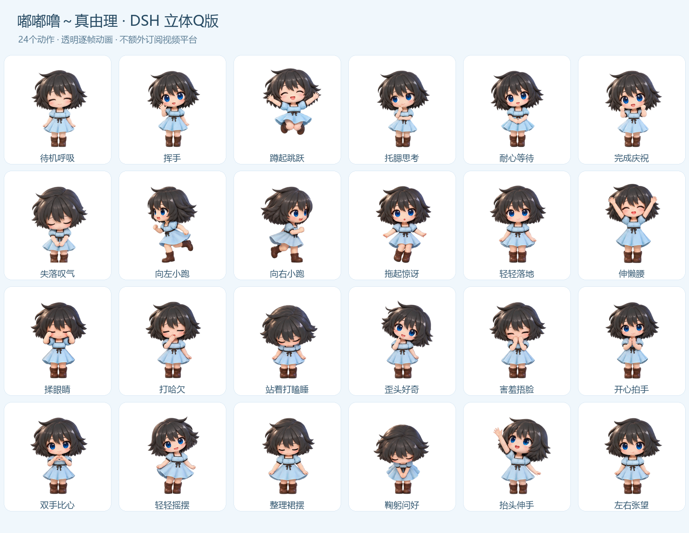

# 真由理 · 立体 Q 版 DSH 宠物

嘟嘟噜～黑色短发、蓝眼睛、浅蓝连衣裙的真由理，24 种透明动画，陪你使用 DeepSeek Harness。

本包是 **dsh-pet 的宠物扩展插件**，需要先安装 `dsh-pet`，再安装本包。普通动画和任务状态联动无需视频平台账号或订阅。

[下载完整安装包](https://github.com/csgreenntr/mayuri-codex-pet/releases/download/dsh-v1.0.0/mayuri-dsh-3d-v1.0.0.zip) · [单独下载插件 TGZ](https://github.com/csgreenntr/mayuri-codex-pet/releases/download/dsh-v1.0.0/dsh-mayuri-pet-1.0.0.tgz) · [文件校验值](https://github.com/csgreenntr/mayuri-codex-pet/releases/download/dsh-v1.0.0/SHA256SUMS-dsh-v1.0.0.txt)



## 安装

适配目标：Windows DSH Desktop `0.2.1-rc.2`，dsh-pet `0.3.7`。其他版本尚未实测。

1. 先在 DSH 的插件管理中安装 `dsh-pet`。已安装可跳过。
2. 将随分发包附带的 `dsh-mayuri-pet-1.0.0.tgz` 保存到固定位置。
3. 在 DSH 插件管理的安装框输入 `file:C:/你的路径/dsh-mayuri-pet-1.0.0.tgz`。也可以双击分发包中的 `安装到DSH.cmd`，使用桌面版自带 CLI 安装。
4. 关闭并重新打开 DSH。真由理默认出现在右下角，也会出现在 DSH 网页界面中。

如果使用 DSH Web，命令为：

```powershell
dsh plugin --profile web add ./dsh-mayuri-pet-1.0.0.tgz
```

## 动作怎么触发

| 操作或状态 | 动作 |
| --- | --- |
| 空闲 | 呼吸、眨眼，偶尔做日常小动作 |
| 左键单击 | 随机挥手、蹲跳、比心或害羞 |
| 拖拽 | 拖起时的小惊讶 |
| 任务思考、工具执行、整理结果 | 安静托腮，约 6.7 秒一轮 |
| 等待用户批准或选择 | 耐心等待 |
| 任务完成 | 开心庆祝 |
| 任务出错 | 失落叹气 |
| 右键 → 动作 → 全部24个动作 | 任意点播全部动作 |

完整动作：待机呼吸、挥手、蹲起跳跃、托腮思考、耐心等待、完成庆祝、失落叹气、向左小跑、向右小跑、拖起惊讶、轻轻落地、伸懒腰、揉眼睛、打哈欠、站着打瞌睡、歪头好奇、害羞捂脸、开心拍手、双手比心、轻轻摇摆、整理裙摆、鞠躬问好、抬头伸手、左右张望。

默认固定在原地；如想自动移动，可手改该宠物配置中的 `fixedEnabled` 和动画权重。所有动作也可从右键菜单手动点播。DSH 的原生拖放/物理行为由 dsh-pet 管理，不承诺每次落地都会自动点播本包的“轻轻落地”；该动作可在菜单中点播。

## 调整大小和显示位置

配置路径为 `$DSH_HOME/dsh-pet/pet/mayuri-3d-config.json`；默认 DSH_HOME 是 `~/.dsh`。

- `pets[0].size` 默认 360，单位像素（透明画布宽度）。
- `display`：`web` 仅界面内，`desktop` 仅桌面，`both` 两处都有，`none` 隐藏。
- `position`：角落与水平、垂直边距。

文件宠物配置请在上面的文件里修改，保存后从桌宠右键菜单重载或重启 DSH。主宠物配置和原有聊天、模型配置不会被本扩展覆盖。

自动碎碎念和余额查询默认关闭。手动点击 dsh-pet 自带的“对话/碎碎念”仍会调用 DSH 中选择的模型，按该服务商的规则使用额度。

## 停用与卸载

在 DSH 插件管理中停用或卸载 `dsh-mayuri-pet`，重启 DSH。正常卸载生命周期会把本宠物配置保留在 `$DSH_HOME/dsh-mayuri-pet/inactive-config.json`，重新启用时恢复；保留的素材不会自动删除。

如 DSH 曾异常退出，卸载后仍有本宠物，可在解压出来的插件文件夹中执行：

```powershell
node scripts/manage.mjs disable
```

该命令只停用本扩展拥有的真由理配置，保留你的修改，不改主宠物。重启 DSH 后生效。

## 制作说明

每个动作由内置生图工具生成 12 张关键帧，统一角色尺度与脚底位置后，进行帧间光流插值，编码成 640×360、24 fps 的透明 VP9 WebM。复杂关节与遮挡处仍可能有轻微插值变形。这是 **3D 渲染风格的逐帧二维动画**，不是实时三维模型。

完整分发包附有预览、生成提示词和验证记录。本包无需构建即可安装。角色来源及非官方同人说明见 [素材说明](DSH-NOTICE.md)。

运行接口依据：[dsh-pet](https://github.com/PC2005-cloud/dsh-pet)。
