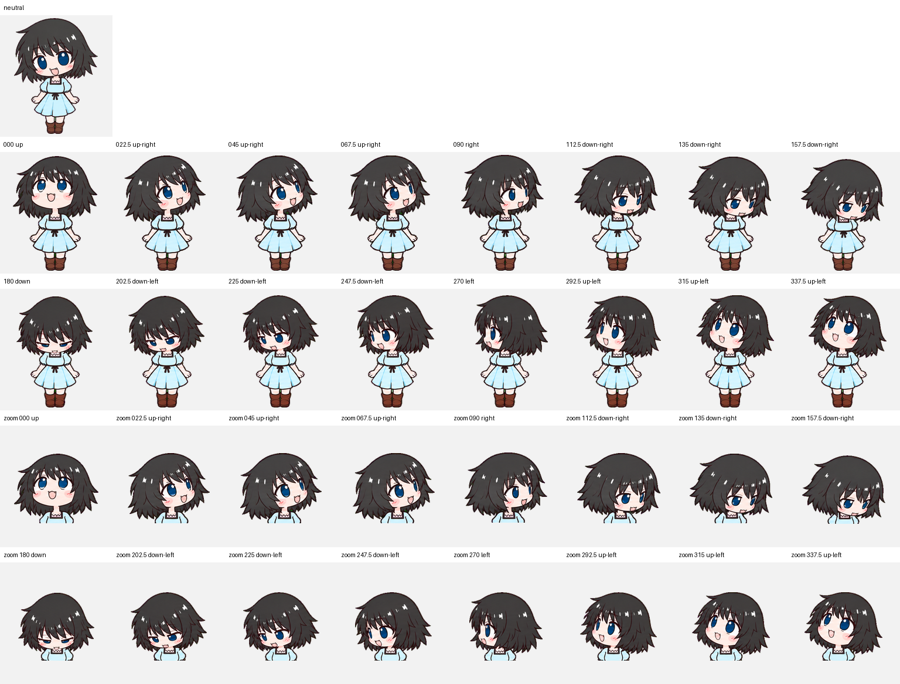

# 真由理 · Q版 Codex 宠物

《命运石之门》椎名真由理的可爱 Q 版宠物：短黑发、蓝色大眼睛、浅蓝连衣裙。保留蹲起跳跃，任务完成且有未读结果时挥手。

Chibi Mayuri Shiina companion for Codex, with a playful hover jump and a wave when completed work is ready to review.

| 蹲起跳跃 | 安静思考 | 完成后挥手 |
| :---: | :---: | :---: |
|  |  |  |

## 下载与安装

1. [下载宠物安装包](mayushii-chibi-v6.zip?raw=true)，解压得到 `mayushii-chibi` 文件夹。
2. 将整个文件夹复制到 Windows 的 `%USERPROFILE%\.codex\pets\` 下。已有同名宠物时，先备份旧文件夹。
3. 打开 Codex 的宠物设置，刷新并选择 **真由理 · Q版**，再用 `/pet` 显示宠物。

安装后的文件结构：

```text
.codex/
└─ pets/
   └─ mayushii-chibi/
      ├─ pet.json
      └─ spritesheet.png
```

如果客户端提供自定义图集上传入口，也可以上传仓库中的 `spritesheet.png`。界面与支持的格式以所用客户端为准。

更新时请确认实际选中的版本。只替换本地文件，可能不会更新宠物库中已经保存的那只宠物。

## 动作与触发

| 动作 | 当前桌面客户端中的触发方式 |
| --- | --- |
| 待机 | 没有其他活动状态，或一段动画播放结束 |
| 向左跑 | 向左拖动宠物 |
| 向右跑 | 向右拖动宠物 |
| 欢迎挥手 | 首次启用时的欢迎状态 |
| 蹲起跳跃 | 鼠标悬停在宠物上 |
| 失落 | 任务出错 |
| 等待回应 | 需要批准、回答或其他输入 |
| 托腮思考 | 任务进行中 |
| 完成挥手 | 任务完成，并有未读结果待查看 |

动作由客户端状态驱动，不会自动按顺序轮播。鼠标悬停、视线跟随和状态优先级可能覆盖其他动画；当前正在查看的对话完成时，也可能立即被视为已读。上述行为可能随客户端版本调整。

本版将完成状态的原画面替换为现有挥手画面，其他动作保持原样。播放时长由客户端决定，本版没有修改客户端，也没有增加左键单击事件。

## 素材规格

- 版本：v6；图集协议：v2。
- 透明 PNG，`1536 × 2288` 像素。
- `8 × 11` 格，每格 `192 × 208` 像素。
- 九种状态槽位，另有十六个视线方向。
- 发布前通过图集结构与质量检查；已核验上传后的像素与本地成品一致。



## 制作与来源

角色及动作由 AI 辅助生成，经过切帧、透明背景处理、位置对齐和图集合成。这是《命运石之门》角色的非官方同人宠物项目，与原作及相关官方产品没有隶属关系。

参考：[原作角色资料](https://steinsgate.jp/darling/character.html) · [官方 Pets 使用说明](https://learn.chatgpt.com/docs/pets)
